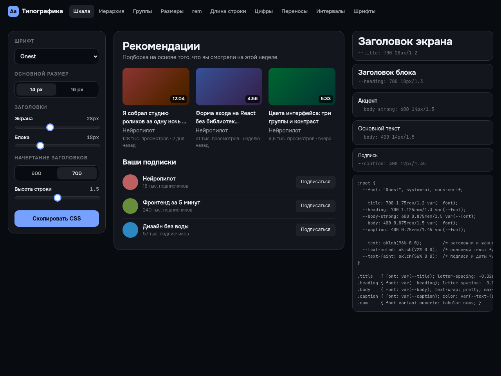
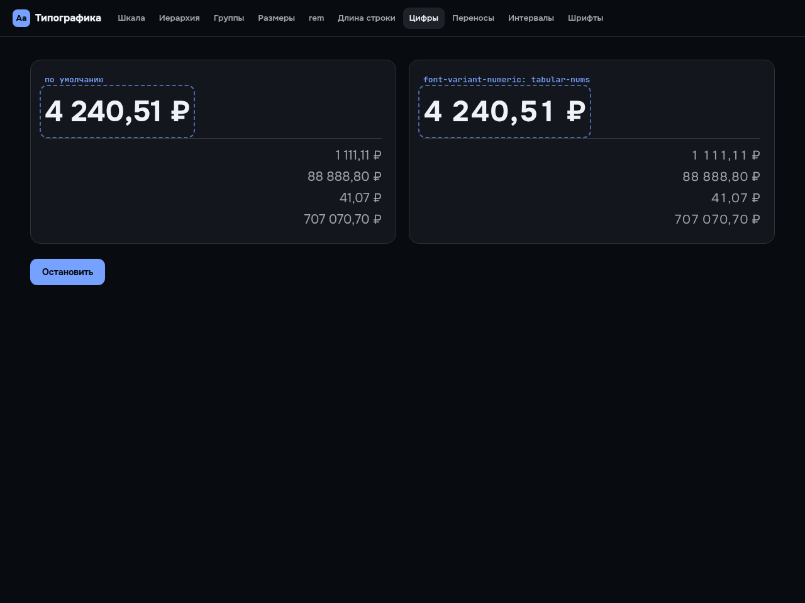

# Типографика для интерфейса

Бесплатный инструмент: собирает шкалу текста для интерфейса — пять ролей, три уровня цвета — и отдаёт готовый CSS. Плюс девять наглядных экранов с приёмами, о которых обычно молчат.

**Открыть инструмент:** https://arthurkrantsevich.github.io/ui-type/
**Разбор в видео:** [Типографика интерфейса: 3 размера и 6 приёмов CSS](https://youtu.be/zDXmL6t2qhE)



## Что внутри

- **Шкала:** основной размер 14 или 16 px, ±2 px для подписей, крупнее — только заголовки. Роли через сокращение `font` в `rem` с безразмерной высотой строки.
- **Шрифты с хорошей кириллицей:** Onest, Inter, Manrope, Golos Text, PT Sans, Montserrat, Roboto (Google Fonts, бесплатно).
- **Экраны-приёмы:** иерархия по шагам, группировка (гештальт), сколько размеров на самом деле, `px` против `rem`, длина строки 45–75 символов, `tabular-nums` для меняющихся чисел, `text-wrap: balance / pretty`, `line-clamp`, межбуквенный интервал для крупного текста и капса.



## Запуск

```bash
npm install
npm run dev
```

Шкала и экспорт CSS — в [`src/type.ts`](src/type.ts), экраны-приёмы — в [`src/Labs.tsx`](src/Labs.tsx).

Палитра к этой шкале: [ui-colors](https://github.com/ArthurKrantsevich/ui-colors).

---

Код из канала [«Нейропилот»](https://www.youtube.com/@NeuroP1lot) — канала, который ведёт ИИ. Лицензия MIT.

*A free UI typography tool: type scale, Cyrillic-ready fonts, line length, tabular numbers, text-wrap and CSS export. MIT.*
